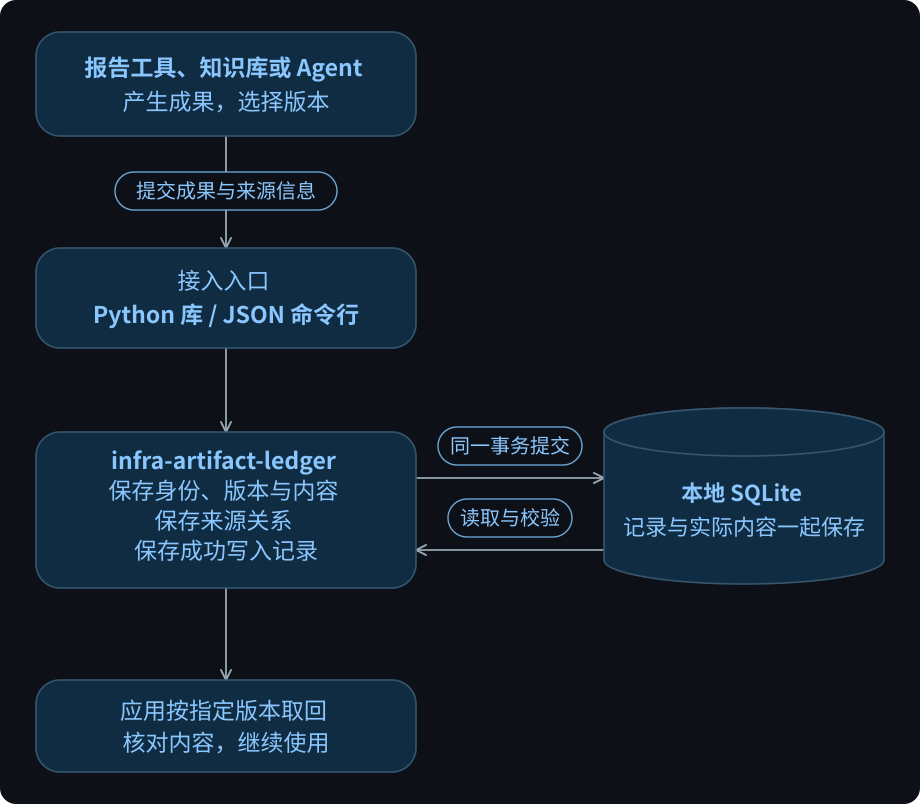
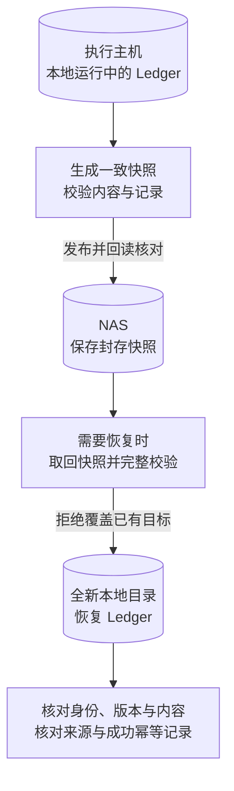

# infra-artifact-ledger

为数字成果保存稳定身份、不可变版本、准确内容和来源关系，支持按指定版本取回、校验与快照恢复。

这里的“制品”是需要保留精确内容和版本的数字成果，例如报告、数据集、工作流定义或模型输出。个人工具、团队应用、知识库和 Agent 都可以通过 Python 库或 JSON 命令行接入，各自管理自己的 Ledger。

**当前版本：`0.2.0a1` alpha · Python 3.11+ · [MIT 许可](LICENSE)。** 从源码构建 wheel 安装，尚未发布 PyPI 包。已验证环境及限制见[兼容表](docs/COMPATIBILITY.md)。

## 它解决什么问题

| 使用者的问题 | Ledger 保存的依据 |
|---|---|
| 这是哪个成果？ | 稳定的成果 ID；身份与文件名、路径、摘要分开 |
| 当时用的是哪一版？ | 独立的版本 ID、版本父关系和保留的旧版本 |
| 当时的内容是什么，有没有损坏？ | 实际内容字节、长度和摘要，可读回校验 |
| 它与哪些材料或成果有关？ | 调用方登记的来源关系与外部引用 |
| 上次保存超时了，再试会不会重复？ | 原请求的幂等身份与成功结果，用于核对或重试 |

例如，一份报告从 **v1 修改成 v2**，两版内容都保留，应用可以记录 v2 来自 v1。以后明确读取 v1，就能取回当时那一版。报告是否正确、是否通过审核、采用哪个版本，由应用决定；内容校验不证明来源真实。

## 在应用中的位置

下图表示接入关系。报告工具、知识库和 Agent 是可采用本组件的应用场景；各项目可以独立安装、各自保存 Ledger。

[查看原图（可缩放）](https://raw.githubusercontent.com/kongbu0621/infra-artifact-ledger/d0545f188c36a206ab625141137e1c02ab694ec9/docs/diagrams/application-position.svg)

Ledger 在本地 SQLite 的同一事务中保存记录、有界内容和成功幂等结果。应用使用公共库或 CLI，无需直接操作数据库表，也不需要模型账号、Agent 框架、云账号或维护者的私有仓库。

应用负责内容生成、业务判断、权限和任务执行；Ledger 保存工作流或脚本时只存储其内容。各项目需要交换记录时，可以使用包含元数据和实际内容的有界完整导出包；导入保留原有身份与历史，并增加本次导入回执。它不提供增量同步。

## 快照与恢复

快照能力用于给受支持的单个 Ledger 生成一致备份，并恢复到全新本地目录。下面是包含 NAS 的目标恢复流程；**本地快照与恢复已通过所列环境的验证，真实 NAS 保存及丢失恢复验收仍未完成。**

图中的执行主机、NAS 和恢复目录是部署角色，具体机器与目录由使用者配置。运行中的 SQLite 位于本机，NAS 保存封存快照；恢复保留原记录和幂等历史，不增加导入回执。

恢复范围是 **Ledger 实际保存的数据**，不包含应用另存的原文件、向量索引、模型或其他数据库。调用方负责准备挂载和保存独立的预期摘要；自动备份调度、挂载、凭据管理和归档轮换由部署侧安排。使用方式见[快照与恢复指南](docs/A2_USAGE.md)。

## 开始使用

1. 查看[兼容表](docs/COMPATIBILITY.md)，按[安装指南](docs/INSTALL.md)在项目独立虚拟环境中安装 `0.2.0a1` wheel。安装环境、源码和数据目录分别管理。
2. 按[接入指南](docs/USAGE.md#2-选择接入方式与数据归属)选择 Python 库或 JSON CLI，准备本地可靠文件系统上的新数据库路径。
3. 跟随[普通报告完整示例](docs/REUSE_EXAMPLE.md)，完成“初始化 → 建立身份 → 保存 v1/v2 → 指定版本读回 → 校验 → 原请求重试核对 → 新库导入”。
4. 需要备份时，按[快照与恢复指南](docs/A2_USAGE.md)使用自己的数据库、存储配置和全新恢复目标。

接入指南和报告示例用于学习基本读写；安装统一使用第 1 步的当前版本构建流程。接入不要求先安装 Code Driver、Local Hand 或模型服务。

| 接入方式 | 公共入口 |
|---|---|
| Python 读写与校验 | `infra_artifact_ledger` |
| Python 快照与恢复 | `infra_artifact_ledger.recovery` |
| JSON 命令行 | `artifact-ledger`，恢复入口为 `artifact-ledger snapshot` |

应用应保留实际采用的版本 ID，以及原写请求的幂等身份和输入。写入响应丢失时，沿原请求核对结果；具体处理见[失败后如何继续](docs/USAGE.md#6-失败后如何继续)。

## 当前能力与边界

| 能力 | 当前状态 |
|---|---|
| 身份、不可变版本、内容与来源记录；读取、校验、原请求重试核对 | 已有 alpha 实现和验证 |
| 有界完整导出 / 导入 | 已有同实现之间的搬运验证 |
| 一致快照、本地校验与新目录恢复 | 已有实现；所列 Linux x86_64 与 GX10 aarch64 环境的安装态本地闭环通过 |
| 真实 NAS 保存与丢失恢复 | 接口已实现，现场验收尚未完成 |
| 两类真实应用采用、独立第二实现兼容 | 待验证 |

具体软件、Python、SQLite、文件系统组合和证据以[兼容表](docs/COMPATIBILITY.md)为准；本地结果不代表所有平台或 NAS 配置可用。当前 alpha 适合在已验证范围内评估和试用。

部署范围是本地单一受信数据域、一个逻辑写入者。当前不提供网络服务、多租户权限、云同步或多机共写数据库。单个内容块（Blob）最多 64 MiB，一个版本包含的全部内容（含复用内容）最多 256 MiB；完整导出包与快照另有容量和格式限制，接入前查看[资源限额](docs/INTERFACE_PROFILE.md#3-资源限额)和[恢复前置条件](docs/A2_USAGE.md#2-准备目录数据库和摘要)。

## 文档

| 想了解什么 | 阅读入口 |
|---|---|
| 如何接入，完成一次真实读写 | [接入指南](docs/USAGE.md) · [报告完整示例](docs/REUSE_EXAMPLE.md) |
| 如何构建安装、备份和恢复 | [安装指南](docs/INSTALL.md) · [快照与恢复指南](docs/A2_USAGE.md) |
| 精确的参数、数据格式和错误语义 | [公共接口](docs/INTERFACE_PROFILE.md) · [恢复接口](docs/a2/INTERFACE_PROFILE.md) |
| 需求、责任边界与内部结构 | [需求](docs/REQUIREMENTS.md) · [架构](docs/ARCHITECTURE.md) |
| 支持哪些环境，有哪些验证依据 | [兼容表](docs/COMPATIBILITY.md) · [基本能力验证](docs/A1_VALIDATION.md) · [恢复能力验证](docs/A2_VALIDATION.md) |

开发过程、阶段记录和任务接续见[开发与接续记录](docs/DEVELOPMENT.md)；参与维护从 [AGENTS.md](AGENTS.md) 开始。
